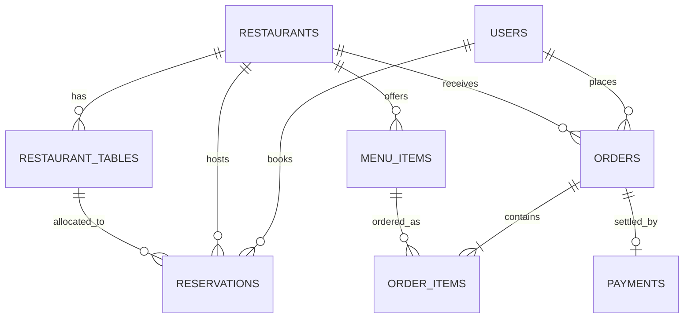

# TABLESERVE Database Schema Documentation

## 1. Entity-Relationship Overview

---

## 2. Table Specifications

### 2.1. `users`
Stores customer, admin, and staff authentication credentials.
| Column | Type | Constraints | Description |
| :--- | :--- | :--- | :--- |
| `id` | VARCHAR(64) | PRIMARY KEY | Unique user ID (e.g. `usr-cust-01`) |
| `name` | VARCHAR(120) | NOT NULL | Customer full name |
| `email` | VARCHAR(180) | UNIQUE, NOT NULL | Login email address |
| `password_hash` | VARCHAR(255) | NOT NULL | Bcrypt hashed password |
| `phone` | VARCHAR(30) | NULL | Contact phone number |
| `role` | VARCHAR(20) | NOT NULL, DEFAULT 'CUSTOMER' | Enum: `CUSTOMER`, `ADMIN`, `STAFF` |
| `created_at` | TIMESTAMP | DEFAULT CURRENT_TIMESTAMP | Account creation timestamp |

### 2.2. `restaurants`
Master catalog of dining establishments.
| Column | Type | Constraints | Description |
| :--- | :--- | :--- | :--- |
| `id` | VARCHAR(64) | PRIMARY KEY | Unique restaurant ID (e.g. `rest-01`) |
| `name` | VARCHAR(150) | NOT NULL | Restaurant display name |
| `description` | TEXT | NULL | Restaurant story & culinary style |
| `cuisine` | VARCHAR(80) | NOT NULL | E.g. Italian, Japanese, Indian |
| `address` | VARCHAR(255) | NOT NULL | Physical street address |
| `city` | VARCHAR(100) | NOT NULL | Metropolitan area / city |
| `phone` | VARCHAR(30) | NULL | Restaurant contact number |
| `image_url` | TEXT | NULL | Exterior / interior photo |
| `rating` | NUMERIC(3,2) | DEFAULT 4.5 | Aggregated star rating (1.0 to 5.0) |
| `price_tier` | VARCHAR(10) | DEFAULT '$$' | Tier: `$`, `$$`, `$$$`, `$$$$` |
| `opening_time` | VARCHAR(10) | DEFAULT '11:00' | Daily opening hour |
| `closing_time` | VARCHAR(10) | DEFAULT '23:00' | Daily closing hour |
| `total_tables` | INT | DEFAULT 12 | Seating inventory size |
| `created_at` | TIMESTAMP | DEFAULT CURRENT_TIMESTAMP | Record created timestamp |

### 2.3. `restaurant_tables`
Physical seating inventory managed for each restaurant.
| Column | Type | Constraints | Description |
| :--- | :--- | :--- | :--- |
| `id` | VARCHAR(64) | PRIMARY KEY | Unique table ID (e.g. `tbl-01-03`) |
| `restaurant_id` | VARCHAR(64) | FK -> `restaurants(id)` | Associated restaurant |
| `table_number` | INT | NOT NULL | Table number in floor plan |
| `capacity` | INT | NOT NULL, DEFAULT 4 | Seating limit (2, 4, 6, 8, etc.) |
| `is_active` | BOOLEAN | DEFAULT TRUE | Operational flag |

### 2.4. `menu_items`
Dishes and drinks served by each restaurant.
| Column | Type | Constraints | Description |
| :--- | :--- | :--- | :--- |
| `id` | VARCHAR(64) | PRIMARY KEY | Unique dish ID (e.g. `menu-01-01`) |
| `restaurant_id` | VARCHAR(64) | FK -> `restaurants(id)` | Restaurant serving this dish |
| `name` | VARCHAR(150) | NOT NULL | Name of dish |
| `description` | TEXT | NULL | Ingredients and preparation |
| `price` | NUMERIC(10,2)| NOT NULL | Unit price in USD |
| `category` | VARCHAR(50) | NOT NULL | Appetizer, Main Course, Dessert, Beverage |
| `dietary_tags`| VARCHAR(150)| DEFAULT '' | E.g. `Vegetarian,Gluten-Free,Halal` |
| `image_url` | TEXT | NULL | High-resolution dish photo |
| `is_available`| BOOLEAN | DEFAULT TRUE | Inventory status |

### 2.5. `reservations`
Booked dining reservations with double-booking prevention constraint.
| Column | Type | Constraints | Description |
| :--- | :--- | :--- | :--- |
| `id` | VARCHAR(64) | PRIMARY KEY | Unique booking ID (e.g. `res-01`) |
| `user_id` | VARCHAR(64) | FK -> `users(id)` | Customer placing reservation |
| `restaurant_id`| VARCHAR(64) | FK -> `restaurants(id)` | Venue booked |
| `table_id` | VARCHAR(64) | FK -> `restaurant_tables(id)`| Allocated physical table |
| `reservation_date`| DATE | NOT NULL | Booking date (`YYYY-MM-DD`) |
| `time_slot` | VARCHAR(10) | NOT NULL | 24-hr slot (e.g. `19:00`) |
| `guests` | INT | NOT NULL, DEFAULT 2 | Party size |
| `status` | VARCHAR(20) | DEFAULT 'CONFIRMED' | `PENDING`, `CONFIRMED`, `CANCELLED` |
| `special_requests`| TEXT | NULL | Notes (e.g. window table) |
| `created_at` | TIMESTAMP | DEFAULT CURRENT_TIMESTAMP | Booking timestamp |

> [!IMPORTANT]
> **Double-Booking Prevention Rule**: A table cannot have more than one non-cancelled reservation on the same `(table_id, reservation_date, time_slot)` combination. Cancellation updates status to `CANCELLED`, instantly releasing the table for new reservations.

### 2.6. `payments`
Simulated payment gateway transactions.
| Column | Type | Constraints | Description |
| :--- | :--- | :--- | :--- |
| `id` | VARCHAR(64) | PRIMARY KEY | Unique payment record ID |
| `reference_type`| VARCHAR(20) | CHECK IN (`RESERVATION`, `ORDER`) | Payment purpose |
| `reference_id` | VARCHAR(64) | NOT NULL | Associated Order or Reservation ID |
| `amount` | NUMERIC(10,2)| NOT NULL | Payment amount |
| `currency` | VARCHAR(10) | DEFAULT 'USD' | Currency code |
| `status` | VARCHAR(20) | DEFAULT 'COMPLETED' | `COMPLETED`, `FAILED`, `REFUNDED` |
| `transaction_id`| VARCHAR(100)| UNIQUE, NOT NULL | Simulated gateway transaction ID |
| `card_last4` | VARCHAR(4) | NULL | Last 4 digits of card |

### 2.7. `orders` & `order_items`
Online ordering and kitchen preparation pipeline.
- `orders`: `id`, `user_id`, `restaurant_id`, `order_type` (`DINE_IN`, `TAKEAWAY`, `DELIVERY`), `table_number`, `total_amount`, `status` (`PLACED`, `PREPARING`, `READY`, `SERVED`, `CANCELLED`), `payment_status`.
- `order_items`: `id`, `order_id`, `menu_item_id`, `name`, `price`, `quantity`, `subtotal`.
